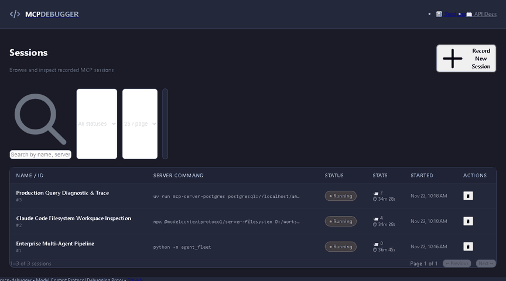

# mcp-debugger

> Transparent proxy to **debug, record, validate, and replay** MCP (Model Context Protocol) sessions.


*Real end-to-end recording of Web UI Multi-Agent Flow & Terminal TUI. Watch the [Full HD Demo Video](docs/demo.mp4).*

[](https://pypi.org/project/mcp-debugger/)
[](https://github.com/sushant-mutnale/mcp-debugger/actions/workflows/ci.yml)
[](https://pypi.org/project/mcp-debugger/)
[](https://opensource.org/licenses/MIT)
[](https://github.com/sushant-mutnale/mcp-debugger/actions)

---

## ✨ Features

| Feature | What it does |
|---|---|
| 🔍 **Record** | Capture every JSON-RPC message between an MCP client and server |
| 📋 **Inspect** | Browse messages with syntax-highlighted, formatted terminal output |
| ⚡ **Live Dashboard** | Real-time terminal TUI (`mcp-debugger live`) monitoring streaming sessions and agent trees |
| 🌐 **Web UI** | Visual interface with interactive Multi-Agent Flow graph, handoff inspect cards, and session explorer |
| 🎯 **Causal Attribution** | Pinpoint failure boundaries (`agent`, `tool`, `protocol`) and isolate Point-of-Commitment via counterfactual step ablation |
| 🤖 **Multi-Agent Trees** | Relational hierarchy trees and inter-agent handoff tracking with context state diffs |
| 🛡️ **CI/CD Quality Gates** | Automated test gates with deterministic exit codes, SARIF v2.1.0, and JUnit XML exporters |
| 💰 **Cost Attribution** | Per-step and per-agent token/dollar accounting with anomaly and budget exceedance flags |
| ✅ **Validate** | Check MCP protocol compliance — handshake order, method names, schemas |
| 🔄 **Replay** | Regression-test server changes by replaying recorded sessions |
| 📊 **Stats** | Visualise tool usage, latency trends, and error rates |
| 🔀 **Compare** | Delta reports between two sessions (latency, errors, tool calls) |
| 📤 **Export** | JSON, Markdown, OpenTelemetry (OTLP), SARIF, or JUnit XML reports |
| 🗄️ **Team Storage** | Zero-config local SQLite with optional PostgreSQL backend (`asyncpg`) |
| ⚙️ **Config** | Persistent user preferences — aliases, timeouts, defaults |
| 🩺 **Doctor** | Environment diagnostics — Python version, SQLite, Node.js, paths |
| 🚀 **Local-first** | No cloud, no signup — all data stays on your machine |

---

## 📦 Installation

```bash
pip install mcp-debugger
```

Optional extensions:

```bash
# OpenTelemetry (OTLP) export
pip install "mcp-debugger[otlp]"

# PostgreSQL team storage backend
pip install "mcp-debugger[postgres]"
```

**Requirements:** Python 3.11+, Node.js (for `npx`-based MCP servers)

---

## 🚀 Quickstart

### 1. Record a session

```bash
mcp-debugger proxy \
  --server "npx -y @modelcontextprotocol/server-filesystem /tmp" \
  --name "my-first-session"
```

Interact with your MCP client (e.g. Claude Desktop). Press `Ctrl+C` to stop.

### 2. List recorded sessions

```bash
mcp-debugger list
```

### 3. Inspect a session

```bash
mcp-debugger inspect 1
```

### 4. Validate protocol compliance

```bash
mcp-debugger validate --server "npx -y @modelcontextprotocol/server-filesystem /tmp"
```

### 5. Replay against a new server version

```bash
mcp-debugger replay 1 --server "npx -y @modelcontextprotocol/server-filesystem /tmp"
```

### 6. Export to Markdown, SARIF, or JUnit
```bash
mcp-debugger export 1 --format markdown --output session-report.md
mcp-debugger export 1 --sarif code-scanning.sarif
```

### 7. Inspect Multi-Agent Hierarchy & Handoffs
```bash
# Visual agent delegation tree
mcp-debugger agents 1

# Inter-agent handoffs table with state diffs
mcp-debugger agents 1 --handoffs
```

### 8. Causal Failure Attribution
```bash
# Isolate Point-of-Commitment and root cause
mcp-debugger attribute 1
```

### 9. Statistical Dashboard & Token Costs
```bash
# View tool usage, latency sparklines, and per-agent token costs
mcp-debugger stats 1
```

### 10. Automated CI/CD Quality Gates
```bash
# Enforce compliance gates with budget thresholds and test reports
mcp-debugger ci 1 --max-cost 2.50 --junit junit-report.xml
```

### 11. Real-Time Terminal TUI Dashboard
```bash
# Live multi-pane monitor: agent execution hierarchy, streaming events, and token costs
mcp-debugger live
```

---

## 🔧 Use with Claude Desktop

Edit your Claude Desktop config (`~/Library/Application Support/Claude/claude_desktop_config.json` on macOS, `%APPDATA%\Claude\claude_desktop_config.json` on Windows):

```json
{
  "mcpServers": {
    "my-filesystem": {
      "command": "mcp-debugger",
      "args": [
        "proxy",
        "--server",
        "npx -y @modelcontextprotocol/server-filesystem /path/to/dir",
        "--name",
        "claude-session"
      ]
    }
  }
}
```

Every message between Claude and your server is now recorded transparently.

---

## 📖 Documentation

| Document | Description |
|---|---|
| [Command Reference](docs/commands.md) | Every CLI command with all options and examples |
| [Web UI](docs/web-ui.md) | How to use the built-in browser interface |
| [Architecture](docs/architecture.md) | How it works — components, data flow, sequence diagrams |
| [Tutorials](docs/tutorials.md) | Step-by-step workflows for common use cases |
| [Configuration](docs/config.md) | All config keys, defaults, and examples |
| [FAQ](docs/faq.md) | Common questions and troubleshooting |
| [Contributing](docs/contributing.md) | Development setup, test structure, PR process |
| [Changelog](CHANGELOG.md) | Version history |

---

## 🧪 Development Setup

```bash
git clone https://github.com/sushant-mutnale/mcp-debugger.git
cd mcp-debugger
python -m venv .venv
source .venv/bin/activate      # Linux/macOS
# or: .venv\Scripts\activate   # Windows
pip install -e ".[dev]"

# Run all tests
pytest

# With coverage
pytest --cov=mcp_debugger --cov-report=term-missing

# Lint and type-check
ruff check .
mypy src/mcp_debugger --ignore-missing-imports
```

---

## 🤝 Contributing

See [CONTRIBUTING.md](CONTRIBUTING.md) for setup instructions, coding style, and pull request process.

---

## 📄 License

MIT © [Sushant Mutnale](https://github.com/sushant-mutnale)
